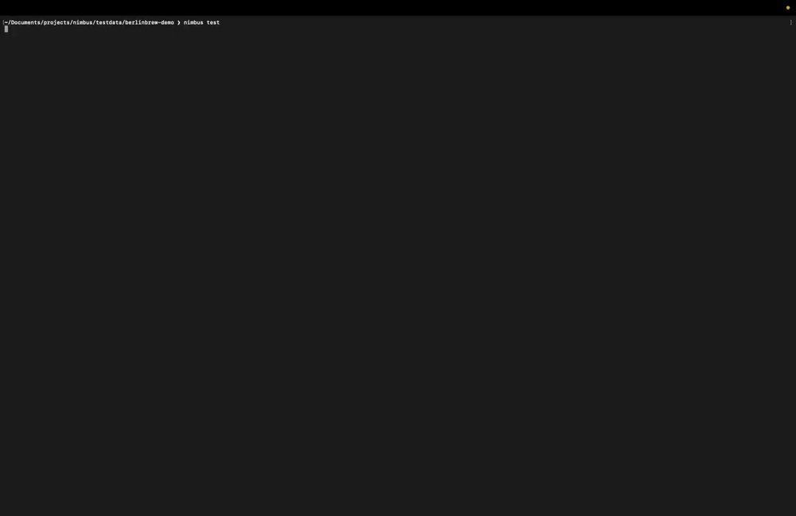
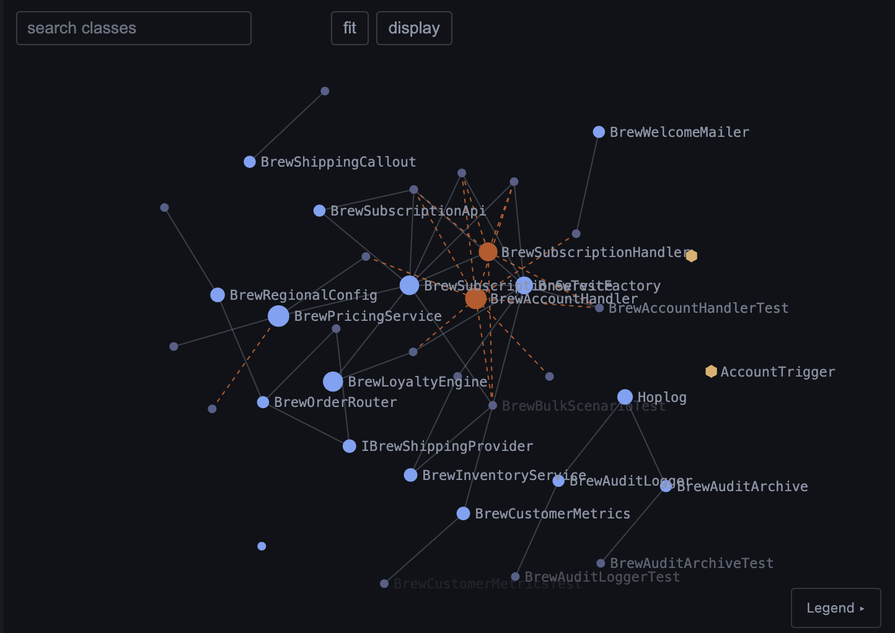

# Renmy — the Salesforce dev toolchain, built on a local Apex runtime

> **Nimbus is now Renmy.** It is the same tool. The `nimbus` command keeps working next to `renmy`, every `NIMBUS_*` environment variable and `nimbus.properties` are still read, and the new home is [renmy.net](https://renmy.net).

**Run, test, debug, and ship Salesforce Apex locally. No org. No Docker. No JVM.**



At its core, Renmy is a **local Apex runtime**: it executes Apex classes,
triggers, Flows, SOQL, and DML on your machine — against a real embedded
PostgreSQL database — so you can **run Apex tests locally without a Salesforce
org**. A typical test finishes in milliseconds, which makes Apex fast enough for
tight TDD loops, agent-driven development, and CI that doesn't depend on a
scratch org pool.

Around that runtime has grown the rest of the toolchain: a Language Server and
live debugger, an interactive dependency graph of your whole codebase, mutation
testing, execution traces, and a release surface that validates and deploys the
same code it just proved — all from one binary.

🌐 **[renmy.net](https://renmy.net)** &nbsp;·&nbsp;
📖 **[Docs](https://renmy.net/docs)** &nbsp;·&nbsp;
🚀 **[Quickstart](https://renmy.net/quickstart)** &nbsp;·&nbsp;
💬 **[Slack](https://join.slack.com/t/nimbuslocalap-tj23081/shared_invite/zt-3x7fxoo38-AAgO9QHP7if53JPunBxOPQ)**

---

## Why Renmy

The Salesforce inner dev loop runs through an org. You change one line, push to a
scratch org or sandbox, wait minutes, and run your tests over the wire. Renmy
removes the org from that loop:

- ⚡ **Tests in milliseconds**, not minutes — no deploy, no round-trip.
- 🗄️ **Real execution, not mocks** — SOQL runs as SQL against embedded
  PostgreSQL, DML persists, triggers fire, Flows execute.
- 🔌 **No org, no credentials, no Docker, no JVM** — a single binary, point it at
  your existing SFDX project and run. Works offline.
- 🕸️ **Your codebase as a graph** — `renmy graph` maps classes, triggers,
  Flows, SObjects, custom metadata, and labels into a dependency graph — in the
  terminal, or the interactive viewer in the Dev UI, VS Code, and JetBrains.
  It includes the edges no static analyzer sees: DML on an object reaching its
  triggers and record-triggered Flows.
- 🚢 **Ship what you proved** — `renmy deploy` runs your local gates, validates
  the same bytes against Salesforce, then deploys. `renmy release` adds signed
  receipts, recorded quality gates, promote & rollback.
- 🤖 **Built for AI agents** — `renmy mcp` exposes the test runner over MCP so
  Claude Code, Cursor, and Copilot can iterate in write-test-fix loops.
- 🧪 **Mutation testing** for Apex — verify your tests actually catch bugs.
- 🧰 **CI-native** — JUnit and Cobertura XML drop straight into GitHub Actions,
  GitLab CI, SonarQube, and Codecov.

## Install

From v1.50.0 the install scripts and Homebrew provide both the `renmy` and the `nimbus` command, and Scoop publishes them as two manifests, `renmy` and `nimbus`. Earlier versions only answer to `nimbus`.

**macOS / Linux**

```bash
curl -fsSL https://install.renmy.net | sh
```

**Homebrew**

```bash
brew install renmy-solutions/nimbus/renmy
```

**Windows (PowerShell)**

```powershell
irm https://renmy.net/install.ps1 | iex
```

**Scoop**

```powershell
scoop bucket add renmy https://github.com/renmy-solutions/scoop-nimbus
scoop install renmy
```

**Salesforce CLI plugin**

```bash
sf plugins install @nimbus-solution/nimbus-sf-plugin
sf renmy login
sf renmy test "*"
```

The plugin source lives in [`sf-plugin/`](sf-plugin/). It installs the native
Renmy runtime automatically, verifies the release checksum, and shares the
same Renmy Pro login as the standalone CLI.

## Quickstart

From the root of your SFDX project:

```bash
# Run every test
renmy test "*"

# Run a class or method pattern
renmy test "AccountServiceTest.*"

# With coverage (Cobertura XML) + JUnit XML test results for CI
renmy test "*" --coverage-report coverage.xml --results-xml results.xml

# What can a change to this class reach? The dependency graph, from the CLI
renmy graph AccountService

# Local gates → Salesforce validation → deploy, in one command
renmy deploy --target-org staging
```

A ready-to-copy GitHub Actions workflow lives in
[`examples/`](examples/) — see also the [CI/CD guide](https://renmy.net/ci).

Renmy reads your `sfdx-project.json`, finds your classes, triggers, and Flows,
and runs your real `@isTest` classes — the same ones that run on the platform.
No copying, no parallel project, no rewriting tests.

No project at hand? Clone
**[berlinbrew-demo](https://github.com/renmy-solutions/berlinbrew-demo)** — a
real-shape Salesforce DX project built to showcase Renmy — and run
`renmy test` in it.

Full guide: **[renmy.net/quickstart](https://renmy.net/quickstart)**

## The toolchain

Everything below ships in the same binary you just installed.

### Real Apex runtime

`renmy test` · `renmy exec` — classes, triggers, SOQL, and DML execute
against an embedded PostgreSQL, with parallel execution. `renmy exec` is
Execute Anonymous, locally.
**[Why an embedded database →](https://renmy.net/why-postgres)**

### Flow testing

Record-triggered, autolaunched, and platform-event Flows (and their subflows)
run alongside your Apex — same DML, same test.
**[Flow testing →](https://renmy.net/flows)**

### Code coverage

Line, method, and branch coverage on every run — console, HTML, JSON, and
Cobertura output. `renmy coverage diff` compares two runs for PR gates: the
delta, per-file regressions, the exact lines that lost coverage.
**[Coverage →](https://renmy.net/coverage)**

### Watch mode

`renmy test:watch` — save a class and the impacted tests re-run in
milliseconds. Dependency-tracked, so only the tests that need to run do. (Pro)
**[Watch mode →](https://renmy.net/watch)**

### Mutation testing for Apex

`renmy mutate` — flips operators, negates conditions, changes returns, and
checks your tests notice. Coverage tells you code ran; this tells you it's
tested. (Pro)
**[Mutation testing →](https://renmy.net/mutation)**

### Test data factories

`renmy fixture` — generates a TestDataFactory from your actual schema: a
`create` method per SObject, required fields populated, required lookups wired
parents-first.
**[Test data →](https://renmy.net/fixture)**

### HTTP callout mocking

Declarative mock responses for callout tests and anonymous execution — URL
pattern matching (Pro), no code changes to your classes.
**[HTTP mocking →](https://renmy.net/docs#http-mock-tests)**

### Governor limits

SOQL, DML, CPU, and heap limits enforced locally — and configurable, so limit
bugs surface on your machine instead of in the org.
**[Governor limits →](https://renmy.net/governor-limits)**

### Managed packages

Run tests that touch managed-package classes: namespace handling, symbol
resolution, stub scaffolding and auto-generation (Pro).
**[Managed packages →](https://renmy.net/managed-packages)**

### Failure intelligence

`renmy explain` · `renmy triage` · `renmy history` — the full account of a
failure (exception, source location, expected vs. actual, the SOQL and DML
just before), failures grouped by cause, and every past run browsable in a TUI.
**[Failure intelligence →](https://renmy.net/explain)**

### Live Apex debugger

`renmy dap` — breakpoints, stepping, and variable inspection over DAP. Live
execution, not log replay. (Pro)
**[Debugger →](https://renmy.net/debugger)**

### Execution traces & analytics

Every test run produces a structured OpenTelemetry trace — method calls, SOQL,
DML, triggers, branches — explorable as a tree, not a 40,000-line debug log. (Pro)
**[Traces & analytics →](https://renmy.net/analytics)**

### Benchmarking

`renmy bench` — run a test method N times and get mean, median, p95, p99, and
governor-limit headroom. Treat Apex performance like any other language. (Pro)
**[Bench →](https://renmy.net/bench)**

### Apex dependency graph

`renmy graph` — classes, triggers, Flows, SObjects, custom metadata, and
labels as one graph, including DML-to-trigger and DML-to-Flow edges no static
analyzer sees. Interactive viewer in the Dev UI, VS Code, and JetBrains.
**[Dependency graph →](https://renmy.net/graph)**



<p align="center"><sub>The dependency graph of <a href="https://github.com/renmy-solutions/berlinbrew-demo">berlinbrew-demo</a> in the interactive viewer — highlighted, what a change to the selected class can reach.</sub></p>

### Browser Dev UI

`renmy dev` — test explorer, coverage, schema browser, and an Apex REPL in
your browser. No editor needed. (`renmy schema` opens the schema explorer
directly.)
**[Dev UI →](https://renmy.net/dev-ui)**

### Apex Language Server

`renmy lsp` — code lenses, inlay hints, semantic tokens, and call hierarchy in
any LSP editor: VS Code, Cursor, Neovim, Zed, JetBrains, Helix, Emacs.
**[Language Server →](https://renmy.net/lsp)**

### Local app hosting

`renmy app` — a local development server for Salesforce Multi-Framework UI
bundles, running your app against the local runtime and database. A drop-in
replacement for `sf ui-bundle dev` that works offline. (Pro)
**[App hosting →](https://renmy.net/app)**

### Gated deploys & assured releases

`renmy deploy` — local gates, Salesforce validation of the same bytes, then
deploy, in one command. `renmy release` adds signed receipts, recorded quality
gates, promote & rollback (Pro). The self-hosted **Assurance console** serves
the whole audit trail — receipts, gate results, deployment history — to your
team. `renmy sf` passes any Salesforce CLI command through untouched.
**[Deploy & release →](https://renmy.net/deploy)** ·
**[Assurance →](https://renmy.net/assurance)**

### MCP server for AI agents

`renmy mcp` — Claude Code, Cursor, and Copilot call the runtime natively for
tight write-test-fix loops, with curated agent skills via `renmy skills`. It
also tests Headless 360 tool surfaces — `@InvocableMethod`, `@AuraEnabled`,
`@RestResource` — locally.
**[Agentic development →](https://renmy.net/agentic)** ·
**[Headless 360 →](https://renmy.net/headless360)**

### Local Salesforce API

`renmy serve` — a Salesforce-compatible REST and Pub/Sub gRPC server on
localhost, for testing integrations without an org. (Pro)
**[Local API →](https://renmy.net/serve)**

### Background daemon

`renmy daemon` — warm the codebase once; every run after that starts in
milliseconds. (Pro)
**[Daemon →](https://renmy.net/daemon)**

### Everything else in the binary

| Command | What it does |
|---|---|
| `renmy validate` | Syntax and apiVersion checks without running tests — catches what the deploy would reject |
| `renmy doctor` | Verify install, project layout, governor settings, runtime version |
| `renmy sync` | Incremental schema sync into the local database (`--rebuild` for full) |
| `renmy orgs` | List SF-CLI-authenticated orgs available for sync and fallback |
| `renmy stub` | Scaffold and inspect `stubs/`, loaded before your main source |
| `renmy new` | Scaffold a class, test class, or trigger with its `-meta.xml` |
| `renmy skills` | Install curated agent skills for Apex development |
| `renmy toolchain` | Pinned Salesforce CLI versions for reproducible CI |
| `renmy config` · `cache` · `db` · `reset` | Configuration and database housekeeping |
| `renmy login` · `status` | Pro license and install status |
| `renmy upgrade` | Self-update in place |

Full reference for every command and flag: **[renmy.net/docs](https://renmy.net/docs)**

## What it supports

| Area | Coverage |
|------|----------|
| **Language** | Classes, interfaces, enums, inheritance, generics, exceptions, all annotations |
| **Data** | SOQL (WHERE, ORDER BY, LIMIT, aggregates, relationships, bind vars), DML (insert/update/delete/upsert/undelete) |
| **Automation** | Before/after triggers, record-triggered Flows, autolaunched Flows, subflows, platform-event Flows |
| **Testing** | `@isTest`, `@testSetup`, `System.assert*`, `Test.startTest/stopTest`, Stub API / ApexMocks, per-test transaction isolation |
| **Insight** | Interactive dependency graph (classes, triggers, Flows, SObjects, custom metadata), `renmy explain`, failure triage, run history, execution traces |
| **Tooling** | Live debugger (DAP), standalone Language Server, browser Dev UI, watch mode, mutation testing, fixture generation, governor-limit enforcement |
| **Ship** | Gated deploys (`renmy deploy`), assured releases with signed receipts (`renmy release`), `sf` pass-through (`renmy sf`), pinned CLI toolchain for CI |
| **CI** | JUnit XML, Cobertura XML, JSON, HTML coverage, release-in-CI templates |
| **AI** | MCP server (`renmy mcp`) for Claude Code, Cursor, Copilot; [agent skills for Apex](https://github.com/renmy-solutions/nimbus-skills) |

Coverage expands every release — see the
**[changelog](https://renmy.net/changelog)**.

## Editor support

The Renmy Language Server is standalone, so it works beyond VS Code: **VS Code,
Cursor, Windsurf, Neovim, Zed, JetBrains, Emacs, Helix.** The
[VS Code extension](https://renmy.net/vscode) is published to both the
Microsoft Marketplace and the
[Open VSX registry](https://open-vsx.org/extension/NimbusSolutions/testnimbus),
and there's a dedicated [JetBrains plugin](https://renmy.net/jetbrains).

## How it compares

- **[vs scratch orgs](https://renmy.net/compare/scratch-orgs)** — milliseconds vs minutes; no DevHub limits.
- **[vs ApexMocks / fflib](https://renmy.net/compare/apexmocks)** — a real database vs stubbed return values.
- **[vs Apex Replay Debugger](https://renmy.net/compare/replay-debugger)** — live breakpoints vs replaying a log.

## Pricing

Free for individual developers, forever — including the runtime, unlimited test
runs, coverage, and gated deploys. Pro and Team add the daemon, parallel
execution, watch mode, the live debugger, mutation testing, the local
Salesforce API, and assured releases. Pro is currently free for every
developer, no card required — see **[pricing](https://renmy.net/#pricing)**.

## Links

- Website — https://renmy.net
- Documentation — https://renmy.net/docs
- Quickstart — https://renmy.net/quickstart
- FAQ — https://renmy.net/faq
- Changelog — https://renmy.net/changelog
- Demo project — https://github.com/renmy-solutions/berlinbrew-demo
- Agent skills for Apex — https://github.com/renmy-solutions/nimbus-skills

---

<sub>Renmy (formerly Nimbus) is a Salesforce dev toolchain and local Apex runtime for developers
who want to run Apex tests locally without an org. Keywords for the humans and
the crawlers: local apex runtime, run apex tests locally, apex test runner,
salesforce apex without org, apex interpreter, apex dependency graph, salesforce
deployment validation, local salesforce development, apex CI without scratch
org.</sub>
